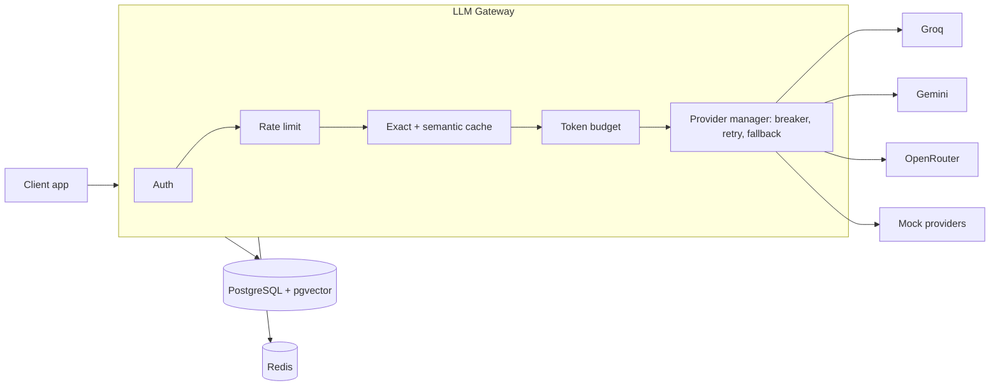

# LLM Gateway — Multi-Provider LLM API Gateway

An **OpenAI-compatible gateway** that sits between your applications and multiple LLM providers (Groq, Gemini, OpenRouter, plus built-in mock providers) and adds authentication, rate limiting, token budgets, exact + semantic caching, provider fallback with circuit breakers, SSE streaming, asynchronous logging and Prometheus metrics. It runs **entirely locally at zero cost**; real provider API keys are optional.

> **Status:** the core system is **verified** — 96 unit tests, 85 integration tests against real PostgreSQL/pgvector and Redis, the full Docker stack, an end-to-end smoke test and GitHub Actions CI all pass (details in [section 19](#19-current-verification-status)). Real LLM providers, a neural embedder and gateway-overhead/throughput benchmarks have **not** been exercised yet; those are marked as such below. Benchmark numbers in [section 14](#14-benchmark-methodology-and-results) were measured by the author on one machine with mock providers and a synthetic workload — read the conditions before quoting them.

## 1. What problem this solves
Applications that call LLM providers directly each re-implement keys, retries, rate limits, cost control and failover — and still go down when one provider does. A gateway centralises that: one OpenAI-style endpoint, per-tenant keys/limits/budgets, caching to avoid paying twice for the same answer, automatic failover when a provider fails, and one place to observe usage and cost.

## 2. Why it exists
A portfolio project demonstrating **reliable backend infrastructure around LLMs** with engineering judgment rather than technology collecting: correctness under concurrency, honest failure semantics, security, observability and testability — with every decision (and every limitation) documented in [docs/ENGINEERING_DECISIONS.md](docs/ENGINEERING_DECISIONS.md).

## 3. Architecture

More diagrams (request lifecycle, fallback, circuit breaker, cache flow, deployment): [docs/ARCHITECTURE.md](docs/ARCHITECTURE.md).

## 4. Features
* `POST /v1/chat/completions` (JSON and **SSE streaming**), `GET /v1/models`; unsupported OpenAI parameters are rejected explicitly.
* Multi-tenant **hashed, revocable API keys**; admin API for tenants/keys/providers.
* **Atomic Redis Lua token-bucket** rate limit; **monthly token budget** (reserve → settle) in PostgreSQL.
* **Exact cache** (Redis) and **semantic cache** (pgvector, tenant- and context-scoped, tunable threshold).
* **Provider abstraction**, fallback with an eligibility policy, bounded jittered retries, per-provider **circuit breaker**.
* **Asynchronous request logging**, estimated cost (configurable pricing, `null` when unknown), Prometheus metrics, `/health` vs `/ready`, request IDs.
* **React dashboard**: provider status and live enable/disable (failover demo), cache stats, cost chart, request table, "Try it" panel.
* Zero-cost **mock providers** with injectable latency, errors and mid-stream failures.

## 5. Tech stack
Node.js 20+/22, TypeScript (strict), Express, PostgreSQL 16 + pgvector, Redis 7, React + Vite, Zod, pino, prom-client, Jest + Supertest, k6, Docker + Compose, GitHub Actions. (Deliberately not used: Kafka, Kubernetes, Terraform, ORMs, GraphQL, vector DBs, … — see the decisions doc.)

## 6. Local setup
> **New to this?** Follow the complete beginner walkthrough: [docs/BEGINNER_GUIDE.md](docs/BEGINNER_GUIDE.md).

```bash
git clone <your-repo-url> llm-gateway && cd llm-gateway
npm install                # also generates package-lock.json: COMMIT IT (CI and Docker use it when present)
npm run setup              # creates .env with random secrets (never overwrites)
npm run infra:up           # PostgreSQL (pgvector) + Redis via docker-compose.dev.yml
npm run migrate
npm run dev                # gateway on http://localhost:8080
npm run create-tenant -- demo      # prints a tenant API key ONCE
npm run dev:dashboard      # dashboard on http://localhost:5173 (sign in with ADMIN_API_TOKEN from .env)
```
> **Windows tip:** if Docker reports `ports are not available ... forbidden by its access permissions` for port 5432, Windows has reserved that port. Add `POSTGRES_PORT=5433` to `.env`, change the port inside `DATABASE_URL` to `5433`, then run `npm run infra:down` and `npm run infra:up` (same idea for `REDIS_PORT`).

## 7. Environment variables
Every variable, its default and meaning: [docs/CONFIGURATION.md](docs/CONFIGURATION.md) (generated from the validated schema; `.env.example` is the template). Essentials:

| Variable | Purpose |
|---|---|
| `DATABASE_URL`, `REDIS_URL` | Required infrastructure. |
| `API_KEY_PEPPER`, `ADMIN_API_TOKEN` | Required secrets (≥32 chars) — `npm run setup` generates them. |
| `MOCK_PROVIDER_ENABLED` | `true` = free local providers, no keys needed. |
| `GROQ_/GEMINI_/OPENROUTER_` `ENABLED`, `API_KEY`, `MODELS` | Optional real providers (disabled by default). |
| `RATE_LIMIT_CAPACITY`, `RATE_LIMIT_REFILL_PER_SEC`, `DEFAULT_MONTHLY_TOKEN_BUDGET` | Limits. |
| `SEMANTIC_CACHE_ENABLED`, `SEMANTIC_CACHE_THRESHOLD` (default 0.92, a starting point, not an optimum), `EMBEDDING_PROVIDER` | Semantic cache. |
| `PROVIDER_TIMEOUT_MS`, `CB_*`, `PROVIDER_MAX_RETRIES` | Reliability. |

## 8. Docker setup
```bash
npm run setup
docker compose up --build        # postgres, redis, one-shot migrate, gateway, dashboard
# dashboard http://localhost:8081   gateway http://localhost:8080   (ports bind to 127.0.0.1)
docker compose run --rm gateway node dist/scripts/create-tenant.js demo
npm run smoke                    # end-to-end API check against the running stack
docker compose down -v           # stop and delete data
```
Containers run as non-root with read-only filesystems and dropped capabilities. Full local verification: `bash scripts/verify.sh` (Windows: `scripts\verify.ps1`).

## 9. Mock provider mode
With `MOCK_PROVIDER_ENABLED=true` (the default in `.env.example`) two mock providers `mock` and `mock-2` serve the model `mock-model` — no API key, no cost. Control them at runtime (admin token):
`POST /api/providers/mock/failure-mode {"mode":"http_503" | "http_500" | "timeout" | "bad_request" | "stream_cut" | "none"}`, `POST /api/providers/mock/disable`. This makes caching, rate limiting, fallback, the circuit breaker, streaming and the dashboard demonstrable without spending anything.

## 10. API usage
```bash
curl -si http://localhost:8080/v1/chat/completions \
  -H "Authorization: Bearer $KEY" -H "Content-Type: application/json" \
  -d '{"model":"mock-model","messages":[{"role":"user","content":"Explain vector databases."}]}'
# -> X-Cache: MISS, X-Provider: mock ; repeat it -> X-Cache: HIT, X-Cache-Type: exact
curl -N ... -d '{"model":"mock-model","stream":true,"messages":[...]}'      # SSE stream, ends with data: [DONE]
```
Reference: [docs/API.md](docs/API.md) · [docs/openapi.yaml](docs/openapi.yaml). Behaviour of each subsystem: [rate limiting](docs/RATE_LIMITING.md), [caching](docs/CACHING.md), [fallback](docs/PROVIDER_FALLBACK.md), [circuit breaker](docs/CIRCUIT_BREAKER.md), [streaming](docs/STREAMING.md), [observability](docs/OBSERVABILITY.md), [database](docs/DATABASE_DESIGN.md).

## 11. Dashboard
`apps/dashboard` (React + Vite, polling, no WebSockets). Admin token kept in memory only. Provider cards with **Disable/Enable** and mock failure modes for live failover demos; cache hit/miss/rate/savings; cost chart (spent vs saved); recent requests with cache/fallback badges; a "Try it" request panel. Dev: `npm run dev:dashboard`; Docker: http://localhost:8081.

## 12. Testing
```bash
npm test                       # unit tests, no services needed
npm run infra:up && npm run test:integration   # Supertest + real PostgreSQL/pgvector + Redis (isolated schema, Redis DB 15)
npm run lint && npm run typecheck
```
Unit tests cover keys, circuit breaker, provider manager, SSE parser, cache keys, semantic scoping, request logger, pricing, config and validation. Integration tests cover auth, rate limiting, token budgets, exact/semantic cache, fallback + circuit breaker, streaming, logging, security and health/metrics — including **concurrency tests** (simultaneous requests against the limiter, budgets and cache).

## 13. Load testing
k6 scripts in `load-tests/` (`gateway.js` overhead, `cache.js` hit rates/cost, `fallback.js` failure recovery), a deterministic upstream stub (`scripts/mock-upstream.js`) and a dataset generator. Procedure: [docs/LOAD_TESTING.md](docs/LOAD_TESTING.md).

## 14. Benchmark methodology and results

Procedure and scripts: [docs/LOAD_TESTING.md](docs/LOAD_TESTING.md) (k6, a deterministic upstream stub, a seeded dataset generator). **Conditions for every number below:** measured by the author on one Windows PC (Docker Desktop, 12 CPUs available to Docker, Node v24), with the built-in **mock providers** and the built-in **lexical (hash) embedder**, a **fresh tenant per run**, rate limits raised so they did not interfere. Prices come from the project's **illustrative** mock price (about $0.10 / $0.20 per million input/output tokens), so only the *percentages* are meaningful, not the dollar amounts. These are single runs on a synthetic workload, not a statistical study.

### Cache hit rate and cost (500-request synthetic workload: 40% new, 27% exact repeats, 33% paraphrases, semantic threshold 0.92)

| Metric | Result |
|---|---|
| Overall cache hit rate | **30.6%** (153 of 500) |
| Exact repeats served from cache | 136 of 136 (**100%**) |
| Never-seen prompts answered from cache (false hits) | 0 of 200 |
| Semantic hits | **0** — the lexical embedder scored real paraphrases below the 0.92 threshold |
| Estimated cost without cache → with cache | $0.0018259 → $0.0013202 (illustrative pricing) |
| **Estimated cost reduction** | **27.7%** |

The hit rate depends on the workload mix as much as on the gateway; always quote it with the mix above.

### Semantic-threshold experiment (same workload, fresh tenant per threshold)

"Correct" = the cached answer belonged to the same topic (checked using the mock provider's echoed prompt; exact hits are correct by definition).

| Threshold | Reported hit rate | Correct hit rate | Wrong answers served | Share of semantic hits that were wrong |
|---|---|---|---|---|
| 0.92 | 30.6% | 30.6% | 0 | no semantic hits |
| 0.85 | 36.4% | **34.6%** | 9 (1.8%) | 28% |
| 0.75 | 67.4% | 31.6% | 179 (35.8%) | 75% |
| 0.65 | 85.0% | 28.4% | 283 (56.6%) | 82% |

**Finding:** lowering the threshold made the reported hit rate look much better while the *correct* hit rate fell and wrong answers rose; with this embedder there is no threshold that is both useful and safe, so the default stays conservative (0.92) and semantic caching should be enabled with a neural embedder and a threshold tuned on labelled pairs (`npm run threshold-sweep`). Limits: synthetic, template-heavy prompts; the correctness check depends on the mock provider echoing the prompt; results with a neural embedder or real traffic will differ.

### Provider failure and recovery (primary mock provider returning HTTP 503, 20 requests/s)

| Metric | Result |
|---|---|
| Requests during a 30 s outage | 601 attempted, **601 served via the fallback provider, 0 failed** |
| Requests during a 10 s outage | 200 attempted, 200 served via fallback, 0 failed |
| Time until the primary served traffic again after it healed | **20.64 s** in the 10 s run (breaker cooldown is 30 s, 10 s had already elapsed); 0.66 s in the 30 s run (cooldown almost over) |

Recovery after healing is bounded by the circuit-breaker cooldown (`CB_COOLDOWN_MS`, default 30 s). Request latency during these runs (~70 ms) includes the mock provider's built-in 50 ms delay and is **not** a gateway-overhead measurement.

### Not measured
Gateway-added latency (p50/p95/p99), maximum sustained throughput, behaviour with real providers, and results with a neural embedder. The k6 procedure for gateway overhead is in `docs/LOAD_TESTING.md` if you want to measure it.

## 15. Dogfooding
Point existing OpenAI-compatible apps at `http://localhost:8080/v1`: [docs/DOGFOODING.md](docs/DOGFOODING.md). Note what it does **not** do: no `/v1/embeddings`, no tool/function calling or JSON mode (rejected with a clear 400).

## 16. Optional AWS
Not required and never executed by the author: [docs/AWS_DEPLOYMENT.md](docs/AWS_DEPLOYMENT.md) (charges warning, no free-tier assumptions, teardown steps). Cost overview: [docs/COST_AND_FREE_TIER_GUIDE.md](docs/COST_AND_FREE_TIER_GUIDE.md).

## 17. Security
Hashed keys (HMAC-SHA256 + pepper), constant-time comparison, Zod validation, body limits enforced after auth, config-only provider URLs with redirects refused, helmet/CORS allowlist, generic error bodies, no secrets or prompts in logs, tenant-scoped caches, hardened containers. Review and open findings: [docs/SECURITY.md](docs/SECURITY.md), [docs/SECURITY_AUDIT.md](docs/SECURITY_AUDIT.md). **Not claimed "secure"**: TLS, network exposure, per-user admin auth and auth-failure throttling are deployment/follow-up items.

## 18. Engineering decisions
Why PostgreSQL/pgvector/Redis, token bucket + Lua, two cache levels, provider abstraction, breaker + fallback, async logging, SSE, mock providers, Compose — and what was deliberately **not** used: [docs/ENGINEERING_DECISIONS.md](docs/ENGINEERING_DECISIONS.md). Interview preparation: [docs/INTERVIEW_GUIDE.md](docs/INTERVIEW_GUIDE.md). Demo walkthrough: [docs/DEMO_SCRIPT.md](docs/DEMO_SCRIPT.md). Troubleshooting: [docs/TROUBLESHOOTING.md](docs/TROUBLESHOOTING.md). Resume/portfolio text (with placeholders): [docs/RESUME_BULLETS.md](docs/RESUME_BULLETS.md), [docs/PORTFOLIO_DESCRIPTION.md](docs/PORTFOLIO_DESCRIPTION.md).

## 19. Current verification status

Legend: **IMPLEMENTED** = written · **VERIFIED** = actually executed (what was run is stated) · **UNVERIFIED / NOT RUN** = never executed.

| Area | Status | Detail |
|---|---|---|
| Source for all components (gateway, packages, dashboard, migrations, Docker, CI, scripts, docs) | IMPLEMENTED | — |
| Install, typecheck (gateway + dashboard), ESLint, production builds (`tsc`, `vite build`) | **VERIFIED** | Windows, Node v24, and GitHub Actions. |
| Unit tests | **VERIFIED** | 12 suites, 96 tests passing (`npm test`). |
| Integration tests incl. concurrency tests | **VERIFIED** | 9 suites, 85 tests passing against real PostgreSQL + pgvector and Redis in Docker. Running them exposed two flawed tests (leaked circuit-breaker state; a timing assumption) and one leaked timer — all fixed. |
| Live demos (dashboard) | **VERIFIED** | Exact cache, semantic cache (similarity 1.0000 hit; 0.8740 miss at threshold 0.92), failover, circuit breaker open/recover, streaming, mid-stream failure, rate limit 429 + refill, metrics. |
| Docker: build, `docker compose up`, nginx proxy (including streaming), healthchecks, `npm run smoke` | **VERIFIED** | 4 services healthy; smoke test 12/12. |
| GitHub Actions CI | **VERIFIED** | All three jobs (quality, integration, docker) green. |
| Benchmarks: cache hit rate, cost reduction, threshold experiment, failover/recovery | **VERIFIED** | Section 14 (single runs, mock providers, synthetic workload). |
| Real providers (Groq / Gemini / OpenRouter), `STREAM_INCLUDE_USAGE`, `transformers` embedder | UNVERIFIED | Never called. |
| Gateway overhead and throughput benchmarks | **NOT RUN** | Procedure in `docs/LOAD_TESTING.md`. |
| `scripts/verify.sh`, `scripts/verify.ps1` | UNVERIFIED | Only the pass/fail logic was exercised with stubbed commands. |
| AWS deployment | **NOT DONE** | Documentation only (`docs/AWS_DEPLOYMENT.md`). |

## 20. Known limitations

* **Cross-vendor failover is not practical yet:** the model name is forwarded to the provider unchanged and vendors name models differently, so failover works between providers that accept the same ID (e.g. the mock providers). A model-alias mapping is the main recommended enhancement.
* **Semantic cache quality:** the built-in embedder is lexical; the threshold experiment shows it cannot separate paraphrases from different topics. Use a neural embedder (optional) and tune on labelled data before enabling it for real traffic.
* **Not implemented:** `/v1/embeddings`, tool/function calling, JSON mode (rejected with a clear 400), multimodal input.
* **Security/ops gaps (see `docs/SECURITY_AUDIT.md`):** a single static admin token, no auth-failure throttling, prompts/responses cached in plaintext until TTL, no log retention, the gateway does not terminate TLS.
* **Per-process state:** circuit-breaker state and runtime provider toggles are not shared across gateway instances.

## License
MIT — see the `LICENSE` file.