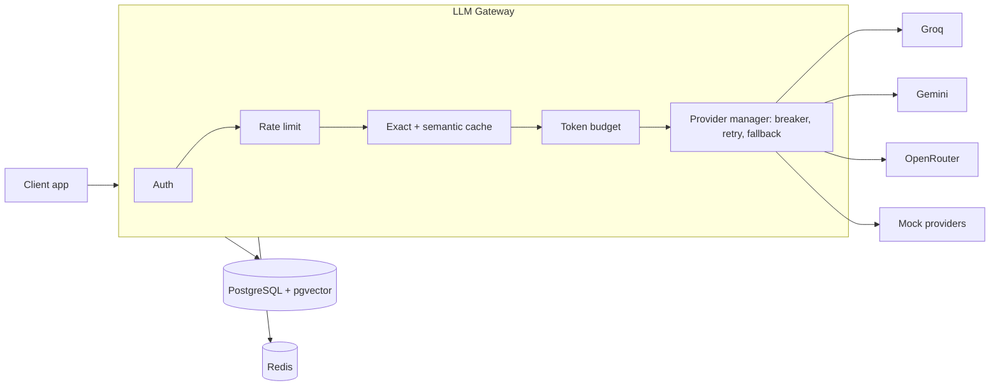

# LLM Gateway — Multi-Provider LLM API Gateway

An **OpenAI-compatible gateway** that sits between your applications and multiple LLM providers (Groq, Gemini, OpenRouter, plus built-in mock providers) and adds authentication, rate limiting, token budgets, exact + semantic caching, provider fallback with circuit breakers, SSE streaming, asynchronous logging and Prometheus metrics. It runs **entirely locally at zero cost**; real provider API keys are optional.

> **Read this first — verification status.** The code, tests, Docker setup, CI and docs are written, The core system is verified (see the table in section 19); real providers, benchmarks and the optional pieces are not yet.

## 1. What problem this solves
Applications that call LLM providers directly each re-implement keys, retries, rate limits, cost control and failover — and still go down when one provider does. A gateway centralises that: one OpenAI-style endpoint, per-tenant keys/limits/budgets, caching to avoid paying twice for the same answer, automatic failover when a provider fails, and one place to observe usage and cost.

## 2. Why it exists
A portfolio project demonstrating **reliable backend infrastructure around LLMs** with engineering judgment rather than technology collecting: correctness under concurrency, honest failure semantics, security, observability and testability — with every decision (and every limitation) documented in [docs/ENGINEERING_DECISIONS.md](docs/ENGINEERING_DECISIONS.md).

## 3. Architecture

More diagrams (request lifecycle, fallback, circuit breaker, cache flow, deployment): [docs/ARCHITECTURE.md](docs/ARCHITECTURE.md).

## 4. Features
* `POST /v1/chat/completions` (JSON and **SSE streaming**), `GET /v1/models`; unsupported OpenAI parameters are rejected explicitly.
* Multi-tenant **hashed, revocable API keys**; admin API for tenants/keys/providers.
* **Atomic Redis Lua token-bucket** rate limit; **monthly token budget** (reserve → settle) in PostgreSQL.
* **Exact cache** (Redis) and **semantic cache** (pgvector, tenant- and context-scoped, tunable threshold).
* **Provider abstraction**, fallback with an eligibility policy, bounded jittered retries, per-provider **circuit breaker**.
* **Asynchronous request logging**, estimated cost (configurable pricing, `null` when unknown), Prometheus metrics, `/health` vs `/ready`, request IDs.
* **React dashboard**: provider status and live enable/disable (failover demo), cache stats, cost chart, request table, "Try it" panel.
* Zero-cost **mock providers** with injectable latency, errors and mid-stream failures.

## 5. Tech stack
Node.js 20+/22, TypeScript (strict), Express, PostgreSQL 16 + pgvector, Redis 7, React + Vite, Zod, pino, prom-client, Jest + Supertest, k6, Docker + Compose, GitHub Actions. (Deliberately not used: Kafka, Kubernetes, Terraform, ORMs, GraphQL, vector DBs, … — see the decisions doc.)

## 6. Local setup
> **New to this?** Follow the complete beginner walkthrough: [docs/BEGINNER_GUIDE.md](docs/BEGINNER_GUIDE.md).

```bash
git clone <your-repo-url> llm-gateway && cd llm-gateway
npm install                # also generates package-lock.json: COMMIT IT (CI and Docker use it when present)
npm run setup              # creates .env with random secrets (never overwrites)
npm run infra:up           # PostgreSQL (pgvector) + Redis via docker-compose.dev.yml
npm run migrate
npm run dev                # gateway on http://localhost:8080
npm run create-tenant -- demo      # prints a tenant API key ONCE
npm run dev:dashboard      # dashboard on http://localhost:5173 (sign in with ADMIN_API_TOKEN from .env)
```

## 7. Environment variables
Every variable, its default and meaning: [docs/CONFIGURATION.md](docs/CONFIGURATION.md) (generated from the validated schema; `.env.example` is the template). Essentials:

| Variable | Purpose |
|---|---|
| `DATABASE_URL`, `REDIS_URL` | Required infrastructure. |
| `API_KEY_PEPPER`, `ADMIN_API_TOKEN` | Required secrets (≥32 chars) — `npm run setup` generates them. |
| `MOCK_PROVIDER_ENABLED` | `true` = free local providers, no keys needed. |
| `GROQ_/GEMINI_/OPENROUTER_` `ENABLED`, `API_KEY`, `MODELS` | Optional real providers (disabled by default). |
| `RATE_LIMIT_CAPACITY`, `RATE_LIMIT_REFILL_PER_SEC`, `DEFAULT_MONTHLY_TOKEN_BUDGET` | Limits. |
| `SEMANTIC_CACHE_ENABLED`, `SEMANTIC_CACHE_THRESHOLD` (default 0.92, a starting point, not an optimum), `EMBEDDING_PROVIDER` | Semantic cache. |
| `PROVIDER_TIMEOUT_MS`, `CB_*`, `PROVIDER_MAX_RETRIES` | Reliability. |

## 8. Docker setup
```bash
npm run setup
docker compose up --build        # postgres, redis, one-shot migrate, gateway, dashboard
# dashboard http://localhost:8081   gateway http://localhost:8080   (ports bind to 127.0.0.1)
docker compose run --rm gateway node dist/scripts/create-tenant.js demo
npm run smoke                    # end-to-end API check against the running stack
docker compose down -v           # stop and delete data
```
Containers run as non-root with read-only filesystems and dropped capabilities. Full local verification: `bash scripts/verify.sh` (Windows: `scripts\verify.ps1`).

## 9. Mock provider mode
With `MOCK_PROVIDER_ENABLED=true` (the default in `.env.example`) two mock providers `mock` and `mock-2` serve the model `mock-model` — no API key, no cost. Control them at runtime (admin token):
`POST /api/providers/mock/failure-mode {"mode":"http_503" | "http_500" | "timeout" | "bad_request" | "stream_cut" | "none"}`, `POST /api/providers/mock/disable`. This makes caching, rate limiting, fallback, the circuit breaker, streaming and the dashboard demonstrable without spending anything.

## 10. API usage
```bash
curl -si http://localhost:8080/v1/chat/completions \
  -H "Authorization: Bearer $KEY" -H "Content-Type: application/json" \
  -d '{"model":"mock-model","messages":[{"role":"user","content":"Explain vector databases."}]}'
# -> X-Cache: MISS, X-Provider: mock ; repeat it -> X-Cache: HIT, X-Cache-Type: exact
curl -N ... -d '{"model":"mock-model","stream":true,"messages":[...]}'      # SSE stream, ends with data: [DONE]
```
Reference: [docs/API.md](docs/API.md) · [docs/openapi.yaml](docs/openapi.yaml). Behaviour of each subsystem: [rate limiting](docs/RATE_LIMITING.md), [caching](docs/CACHING.md), [fallback](docs/PROVIDER_FALLBACK.md), [circuit breaker](docs/CIRCUIT_BREAKER.md), [streaming](docs/STREAMING.md), [observability](docs/OBSERVABILITY.md), [database](docs/DATABASE_DESIGN.md).

## 11. Dashboard
`apps/dashboard` (React + Vite, polling, no WebSockets). Admin token kept in memory only. Provider cards with **Disable/Enable** and mock failure modes for live failover demos; cache hit/miss/rate/savings; cost chart (spent vs saved); recent requests with cache/fallback badges; a "Try it" request panel. Dev: `npm run dev:dashboard`; Docker: http://localhost:8081.

## 12. Testing
```bash
npm test                       # unit tests, no services needed
npm run infra:up && npm run test:integration   # Supertest + real PostgreSQL/pgvector + Redis (isolated schema, Redis DB 15)
npm run lint && npm run typecheck
```
Unit tests cover keys, circuit breaker, provider manager, SSE parser, cache keys, semantic scoping, request logger, pricing, config and validation. Integration tests cover auth, rate limiting, token budgets, exact/semantic cache, fallback + circuit breaker, streaming, logging, security and health/metrics — including **concurrency tests** (simultaneous requests against the limiter, budgets and cache).

## 13. Load testing
k6 scripts in `load-tests/` (`gateway.js` overhead, `cache.js` hit rates/cost, `fallback.js` failure recovery), a deterministic upstream stub (`scripts/mock-upstream.js`) and a dataset generator. Procedure: [docs/LOAD_TESTING.md](docs/LOAD_TESTING.md).

## 14. Benchmark methodology
Four benchmarks — cache hit rate, gateway overhead (client→upstream vs client→gateway→upstream against the *same* deterministic upstream, open-model arrival rate), estimated cost with vs without cache, and provider failure recovery — with explicit caveats in the load-testing doc. **Results (all not yet measured):**

| Metric | Value |
|---|---|
| Cache hit rate | TBD |
| p95 gateway overhead | TBD |
| Estimated cost savings | TBD |
| Fallback recovery rate | TBD |
| Throughput | TBD |

## 15. Dogfooding
Point existing OpenAI-compatible apps at `http://localhost:8080/v1`: [docs/DOGFOODING.md](docs/DOGFOODING.md). Note what it does **not** do: no `/v1/embeddings`, no tool/function calling or JSON mode (rejected with a clear 400).

## 16. Optional AWS
Not required and never executed by the author: [docs/AWS_DEPLOYMENT.md](docs/AWS_DEPLOYMENT.md) (charges warning, no free-tier assumptions, teardown steps). Cost overview: [docs/COST_AND_FREE_TIER_GUIDE.md](docs/COST_AND_FREE_TIER_GUIDE.md).

## 17. Security
Hashed keys (HMAC-SHA256 + pepper), constant-time comparison, Zod validation, body limits enforced after auth, config-only provider URLs with redirects refused, helmet/CORS allowlist, generic error bodies, no secrets or prompts in logs, tenant-scoped caches, hardened containers. Review and open findings: [docs/SECURITY.md](docs/SECURITY.md), [docs/SECURITY_AUDIT.md](docs/SECURITY_AUDIT.md). **Not claimed "secure"**: TLS, network exposure, per-user admin auth and auth-failure throttling are deployment/follow-up items.

## 18. Engineering decisions
Why PostgreSQL/pgvector/Redis, token bucket + Lua, two cache levels, provider abstraction, breaker + fallback, async logging, SSE, mock providers, Compose — and what was deliberately **not** used: [docs/ENGINEERING_DECISIONS.md](docs/ENGINEERING_DECISIONS.md). Interview preparation: [docs/INTERVIEW_GUIDE.md](docs/INTERVIEW_GUIDE.md). Demo walkthrough: [docs/DEMO_SCRIPT.md](docs/DEMO_SCRIPT.md). Troubleshooting: [docs/TROUBLESHOOTING.md](docs/TROUBLESHOOTING.md). Resume/portfolio text (with placeholders): [docs/RESUME_BULLETS.md](docs/RESUME_BULLETS.md), [docs/PORTFOLIO_DESCRIPTION.md](docs/PORTFOLIO_DESCRIPTION.md).

## 19. Current verification status

Legend: **IMPLEMENTED** = code/doc written · **VERIFIED** = actually executed, with what was executed · **UNVERIFIED** = written but never run.

| Area | Status | Detail |
|---|---|---|
| Source for all phases | IMPLEMENTED | — |
| `npm install`, typecheck (gateway + dashboard), ESLint, `vite build` | **VERIFIED** | Run on Windows with Node v24 and in GitHub Actions. |
| Unit tests (96) | **VERIFIED** | `npm test`: 12 suites, 96 tests passing. |
| Integration tests (85, incl. concurrency tests) | **VERIFIED** | `npm run test:integration` against real PostgreSQL/pgvector and Redis in Docker: 85/85 passing. Two flawed tests were found and fixed (shared circuit-breaker state, a timing assumption). |
| Manual end-to-end demos | **VERIFIED** | Exact cache, semantic cache (similarity 1.0000 hit, 0.8740 miss), failover, circuit breaker open/recover, streaming, mid-stream failure, rate limit 429 + refill, metrics. |
| Docker: build, `docker compose up --build`, nginx proxy, healthchecks, `npm run smoke` (12/12) | **VERIFIED** | Dashboard streaming through nginx works. |
| GitHub Actions CI (quality, integration, docker jobs) | **VERIFIED** | First run green. |
| Real providers (Groq/Gemini/OpenRouter), `transformers` embedder, streaming usage option | UNVERIFIED | Never called. |
| k6 scripts and all benchmarks | **NOT RUN** | Values remain `TBD` until measured. |
| `scripts/verify.sh`, `scripts/verify.ps1` | UNVERIFIED | Only the logic was tested with stubs. |
| AWS deployment | **NOT DONE** | Documentation only. |
**Recommended first steps on your machine:** `npm install` (commit the lockfile) → `npm run lint && npm run typecheck && npm test` → `npm run infra:up && npm run test:integration` → `docker compose up --build && npm run smoke` → fix anything that surfaces → run the benchmarks → then fill in the `TBD` values with your own measurements.

## License
MIT (add a `LICENSE` file before publishing).
