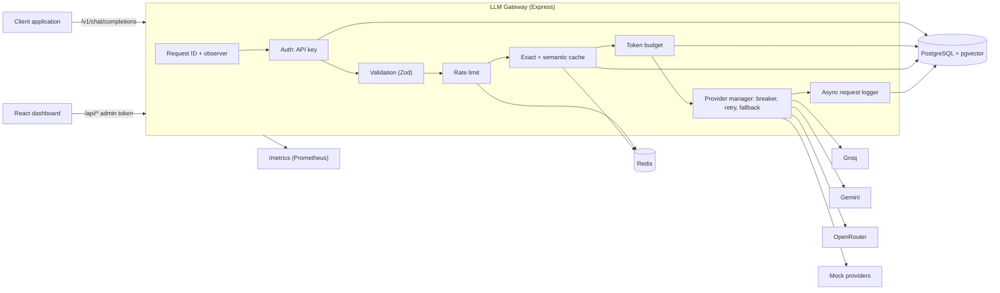
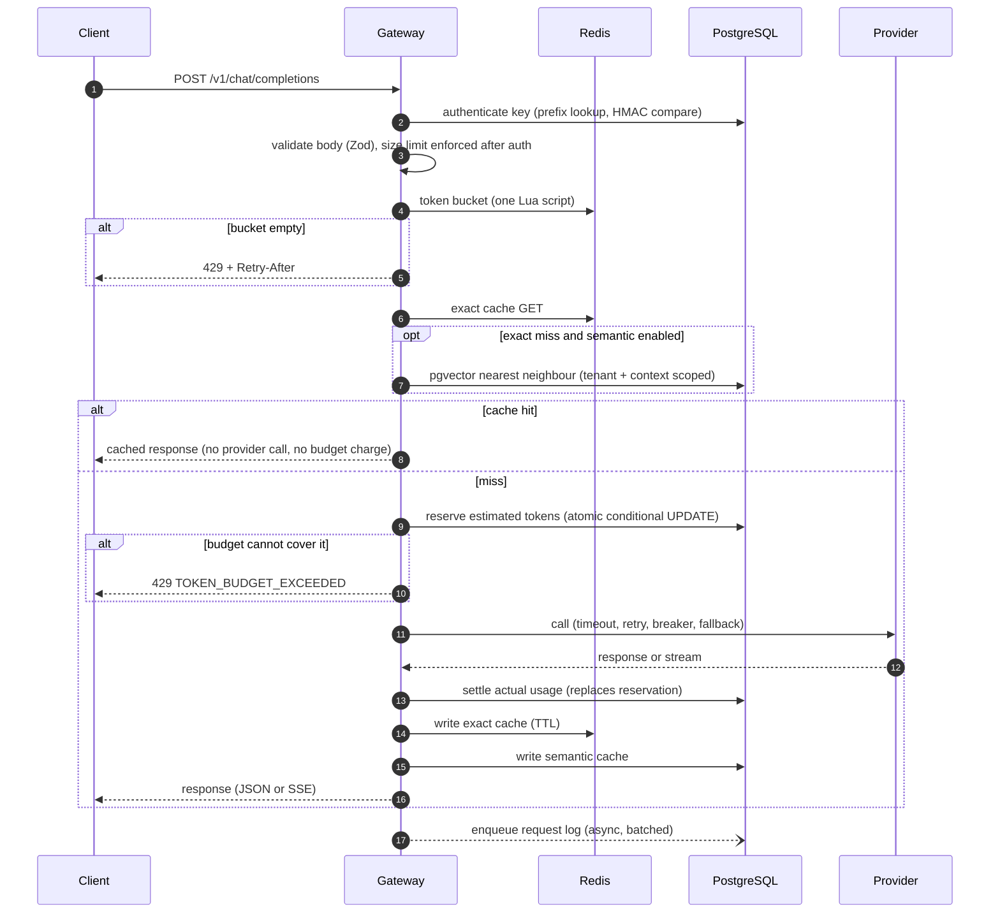
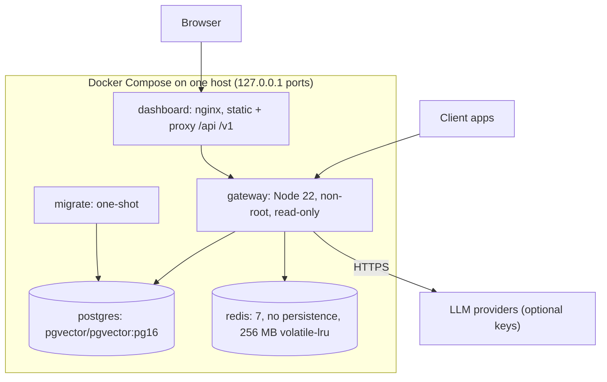

# Architecture

The gateway is a single Node.js/TypeScript (Express) process in front of one or more LLM providers. State lives in two
stores with deliberately different roles: **PostgreSQL** (durable: tenants, keys, usage, logs, semantic cache) and **Redis**
(disposable: rate-limit buckets, exact cache). Provider state (circuit breakers, runtime toggles in memory) is per process.

## System architecture

## Request lifecycle

Metrics and the access log are produced when the response closes, off the request path; the request-log row is queued in memory and written in batches.

## Layers and modules

| Path | Responsibility |
|---|---|
| `apps/gateway/src/app.ts`, `routes/*`, `middleware/*` | HTTP surface: routing, auth middleware, validation, error mapping, SSE writer, observer. |
| `apps/gateway/src/bootstrap.ts` | Builds the dependency graph from config + connections (shared by the server and integration tests). |
| `packages/providers` | `LLMProvider` interface, `ProviderManager` (routing, fallback, retries), `CircuitBreaker`, OpenAI-compatible adapter, SSE parser, mock provider. |
| `packages/cache` | Exact cache (Redis), semantic cache (pgvector), embedding providers. |
| `packages/rate-limit` | Lua token bucket (Redis), reserve/settle token budget (PostgreSQL). |
| `packages/auth` | API key generation/hashing, repository. |
| `packages/database` | Pool, migrations, async request logger. |
| `packages/metrics` | Prometheus registry and recording helpers. |
| `packages/config`, `packages/shared` | Validated config; errors, logger, pricing, token estimate, constants. |

Business logic depends on the `LLMProvider` interface and `ProviderManager` only; provider-specific code is confined to the adapter and registry. Dependencies are injected (`Deps`), which is what lets integration tests run the real wiring.

## Where state lives

| State | Store | Why |
|---|---|---|
| Tenants, API key hashes, budgets, usage, request logs, audit, provider toggles | PostgreSQL | Durable, relational, transactional. |
| Semantic cache | PostgreSQL + pgvector | Needs vector similarity search; also durable across restarts. |
| Rate-limit buckets, exact cache | Redis | Atomic scripts, TTLs, very cheap reads; loss is harmless. |
| Circuit breaker state | Process memory | Fast path, no dependency; per instance (see CIRCUIT_BREAKER.md). |
| Request-log queue | Process memory | Keeps logging off the request path (see OBSERVABILITY.md). |

## Deployment architecture

Compose is the canonical deployment. An optional AWS variant is described (and unexecuted) in `AWS_DEPLOYMENT.md`.

## Scaling notes (what is and isn't built)

The gateway process is stateless apart from breaker state, toggles and the log queue, so it can run as several instances behind a
load balancer. Honest limits of the current design: the auth lookup and budget reserve/settle each hit PostgreSQL on every request
(per-tenant budget updates serialise on one row), breakers and runtime toggles are per instance, and the dashboard reads from the
request-log table. See `INTERVIEW_GUIDE.md` (system design) for what would change at 1k / 100k requests per second.
