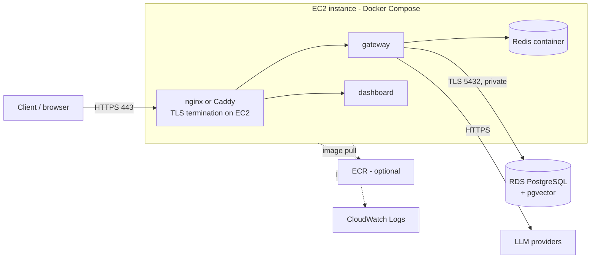

# Optional: deploying to AWS

> **OPTIONAL. The project does not need AWS.** The canonical deployment is local Docker Compose (`docker compose up --build`)
> at zero cost. Nothing in this repository requires an AWS account.
>
> **Status: this guide has NEVER been executed.** No deployment was performed by the author, so every step is UNVERIFIED and
> may need adjustment. Do not present this project as "deployed on AWS" unless you actually deploy it yourself.
>
> **Cost warning.** AWS free-tier eligibility, durations and prices change and differ by account age and region. Nothing here
> is claimed to be free. Read the current [AWS Free Tier](https://aws.amazon.com/free/) terms and set a billing alarm
> **before** creating resources. You are responsible for any charges.

## Architecture (single-host, smallest reasonable shape)

* **Compute:** one EC2 instance running the compose stack (gateway + dashboard + Redis).
* **Database:** RDS for PostgreSQL with the `pgvector` extension. **Verify** that your chosen engine version/region supports
  `CREATE EXTENSION vector` before provisioning; do not assume it. (Alternative with no RDS: keep the Postgres container on the
  instance with an EBS volume and backups you manage yourself — cheaper, but you own durability.)
* **Redis:** the container from the compose file. It holds only disposable cache/rate-limit state, so no managed Redis is needed
  (ElastiCache is a paid service; do not assume a free tier).
* **Images:** build on the instance, or push to ECR (ECR storage can incur charges).
* **Logs:** `docker logs` is enough; CloudWatch Logs is optional and billed by ingestion/storage.

## Resources that can generate charges

| Resource | Why it may cost money |
|---|---|
| EC2 instance | Per-hour compute while running (even if idle). |
| EBS volumes / snapshots | Billed while they exist, even if the instance is stopped. |
| **Public IPv4 addresses** | AWS charges for public IPv4 addresses (including ones attached to free-tier instances); check current pricing. |
| Elastic IP | Billed when allocated but not attached, and under the public-IPv4 policy. |
| RDS instance, storage, backups | Hourly instance cost + storage + backup storage beyond allowance; Multi-AZ doubles instance cost. |
| NAT Gateway | Hourly + per-GB. **Not needed here — avoid creating one.** |
| Application/Network Load Balancer | Hourly + LCU. Not needed for a single host. |
| ECR | Image storage and data transfer. |
| CloudWatch Logs / metrics / alarms | Ingestion, storage, custom metrics. |
| Data transfer out | Internet egress beyond allowances. |

## Outline (adapt to current console/CLI)

1. **Account safety first:** enable MFA on the root user, create an IAM admin user, create a **budget with email alerts**.
2. **Network:** use the default VPC or a simple one; no NAT gateway. Security groups:
   * EC2: inbound 443 (and 80 for certificate issuance) from the internet; SSH 22 **only from your IP** (or use SSM Session Manager and open no SSH port).
   * RDS: inbound 5432 **only from the EC2 security group**; not publicly accessible.
3. **Database:** create the RDS PostgreSQL instance (smallest class you accept), enforce SSL, then connect once from the EC2 host and run
   `CREATE EXTENSION IF NOT EXISTS vector;` (requires a privileged role). If this fails, your engine version lacks pgvector — choose another version or the container option.
4. **Instance:** launch an instance (x86_64 or arm64 — build images for the matching architecture), install Docker + Compose plugin.
5. **Secrets:** generate with `node scripts/gen-env.js` on the host. Set `DATABASE_URL` to the RDS endpoint
   (`...?sslmode=require`), set provider keys if you use real providers. Keep `.env` mode 600; never commit it.
   (AWS SSM Parameter Store / Secrets Manager are alternatives; check their current pricing.)
6. **Compose changes for this topology:** remove the `postgres` service and the `depends_on` entries that reference it, point
   `DATABASE_URL` at RDS, and keep `NODE_ENV=production`. Run `docker compose run --rm migrate` once.
7. **TLS:** put Caddy/nginx with a real certificate in front of the dashboard/gateway ports (they bind to 127.0.0.1 by default,
   deliberately). Do **not** expose the gateway's ports directly.
8. **Smoke test:** `GATEWAY_URL=https://your-host node scripts/smoke.js` (set `ADMIN_API_TOKEN`).
9. **Lock down the admin surface:** `/api/*` is guarded only by `ADMIN_API_TOKEN` (no per-user identity). Restrict it by IP at the proxy,
   keep the token long and secret, and consider not exposing `/api` publicly at all.

## Shutdown and deletion (do this when you are done)

Stopping an instance does **not** stop all charges. To stop paying, delete:

1. `docker compose down -v` (optional, on the host).
2. **Terminate** the EC2 instance; confirm its EBS volumes are deleted (check "Volumes").
3. **Release** any Elastic IPs.
4. **Delete the RDS instance**; decide whether to take a final snapshot, then delete manual snapshots and automated backups you no longer want.
5. Delete ECR repositories/images, CloudWatch log groups, and any alarms or parameters you created.
6. Delete unused security groups / key pairs.
7. Next day, open **Billing → Cost Explorer / Bills** and confirm there are no running resources or new charges.

## What was deliberately left out

Kubernetes/ECS/EKS, Terraform, load balancers and NAT gateways: unnecessary for this project's scale, and each adds cost and
operational surface. See `docs/ENGINEERING_DECISIONS.md` (Phase 11).
