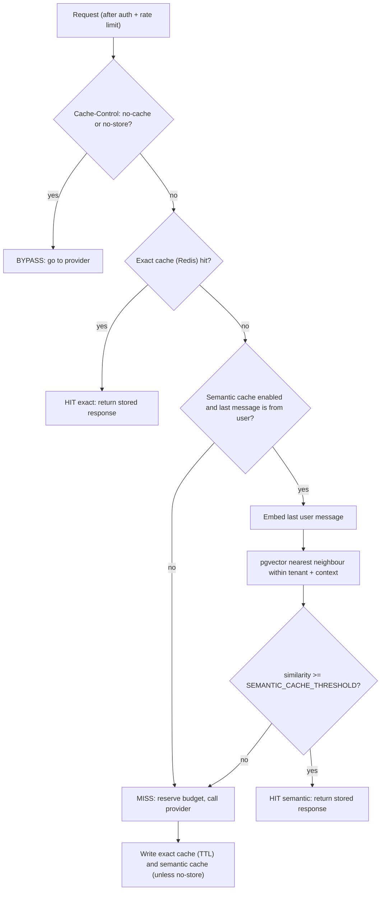

# Caching

Two levels, consulted in order, both **scoped per tenant** (one tenant's answers are never served to, or probeable by, another):



Hits make no provider call and charge no token budget. Redis or embedding failures degrade to a miss, never to an error.

## Exact cache (Redis)

Key: `llmgw:v1:cache:<sha256>` where the hash covers a canonical JSON array of **tenant, model, every message (role + exact content), temperature,
top_p, max_tokens, sorted stop sequences**. Unset parameters hash as `null`, so "unset" never collides with an explicit value, and message-boundary shifting
cannot collide. The provider is deliberately **not** in the key: a cached answer is served whichever provider first produced it.

Entry: response body, model, provider, provider-reported usage (or null), creation time. TTL `EXACT_CACHE_TTL_SECONDS` (default 1 h) on every key;
entries larger than `EXACT_CACHE_MAX_BYTES` are skipped; Redis runs with `maxmemory 256mb` and `volatile-lru`, so growth is bounded.

### Correctness model
* **Parameters:** anything that changes the provider request is in the key. Parameters the gateway ignores (e.g. `seed`, `presence_penalty`) are neither forwarded nor keyed, so they cannot create inconsistent hits. Unsupported parameters are rejected, not dropped.
* **Sampling:** with `temperature > 0` a hit returns a *previously sampled* answer. Clients that need a fresh sample send `Cache-Control: no-cache`.
* **Model/provider changes:** the model is in the key; a provider switch does not invalidate (same model name ⇒ same cache entry).
* **Prompt normalisation:** none beyond canonical JSON — whitespace or casing differences are different keys (the semantic cache is the fuzzy layer).

### Invalidation
TTL expiry; `Cache-Control: no-cache` (read skipped, entry refreshed); changing the key shape → bump `KEY_NS` (`llmgw:v1` → `v2`) which orphans old keys (they expire by TTL);
emergency: `redis-cli FLUSHDB`. There is no per-entry delete API.

## Semantic cache (PostgreSQL + pgvector)

Only the **final user message** is embedded and compared. Everything else must match **exactly** via `context_hash` (model, temperature, top_p, max_tokens, stop, the system
prompt and all earlier turns). This is the main protection against wrong hits: a similar question asked under a different system prompt, model or sampling setting
can never be answered from that entry. Requests that do not end in a user message skip the semantic cache.

Lookup: `ORDER BY embedding <=> query LIMIT 1` within `(tenant_id, context_hash, not expired)`; accept if `1 - distance >= SEMANTIC_CACHE_THRESHOLD`.
Every response reports `X-Semantic-Similarity` for the nearest candidate (hit or miss), which makes live tuning possible.

### Threshold trade-off (and why 0.92 is only a default)

```text
Higher threshold -> fewer incorrect matches  -> lower hit rate
Lower threshold  -> more hits                -> higher risk of an inappropriate answer
```
0.92 is a conservative starting point, **not** a claimed optimum; the right value depends on the embedder and your traffic. Tune it empirically:
`npm run threshold-sweep -- pairs.jsonl` prints precision/recall per threshold from labelled prompt pairs, and `docs/LOAD_TESTING.md` (Benchmark 1) measures hit rates end to end.
Prefer high precision: a wrong cached answer is worse than a miss.

### Embedders
| Provider | Cost | Quality | Notes |
|---|---|---|---|
| `hash` (default) | free, no dependencies | **lexical overlap only** | Deterministic; makes the pipeline testable. It cannot tell paraphrases from different-entity questions. |
| `transformers` | free, local (CPU, ~90 MB one-time model download) | real semantic embeddings (all-MiniLM-L6-v2, 384-d) | Optional: `npm i @xenova/transformers`. **Not exercised in this repo yet.** |

Observed on four hand-written pairs (not a benchmark): identical prompts scored 1.000, a close paraphrase 0.601, "capital of France" vs "capital of Germany" 0.808, unrelated 0.000.
So with `hash` the default threshold is safe but rarely produces semantic hits; use `transformers` (or another `EmbeddingProvider` implementation) for real paraphrase matching.
The `EmbeddingProvider` interface (`embed(text) -> number[384]`) is the plug-in point for another embedder.

## Known limitations
* **No single-flight:** simultaneous identical misses may each call the provider (all results are identical in effect; the last write wins).
* **Stored prompts:** `semantic_cache.prompt_text` and cached responses sit in plaintext in PostgreSQL/Redis. Treat them like the data they come from.
* **Row growth:** semantic rows are bounded by TTL and the per-tenant rate limit, with no per-tenant row cap.
* **Hit responses reuse the original `id`/`created`.** Streamed hits are replayed as one content chunk, not true provider streaming.
