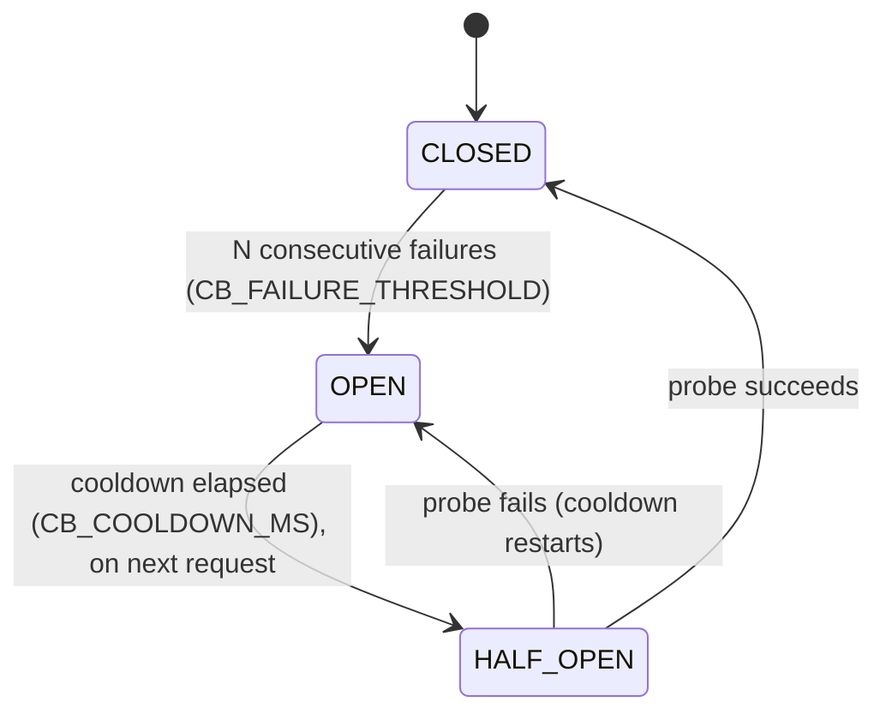

# Circuit breaker

Each provider has its own breaker (`packages/providers/src/circuitBreaker.ts`). Its job: when a provider is clearly failing, **stop sending it traffic**
so requests fail over immediately instead of each paying a timeout, and so the provider gets room to recover instead of being hammered.

| Setting | Default | Meaning |
|---|---|---|
| `CB_FAILURE_THRESHOLD` | 5 | Consecutive failures while CLOSED that open the breaker. A success resets the count. |
| `CB_COOLDOWN_MS` | 30000 | Time OPEN before a probe is allowed. |
| `CB_HALF_OPEN_MAX_REQUESTS` | 1 | Concurrent probe requests in HALF_OPEN; extra requests are rejected (they fail over). |

## Failure counting
Counted: timeout, network error, upstream 5xx, upstream 429, malformed response, and a rejected credential (401/403). Not counted: client errors (400/404/422) — the provider
*answered*, so they count as a healthy response — and client disconnects (neutral: the probe slot is released without judging the provider).
Retries count too, so `PROVIDER_MAX_RETRIES=1` with threshold 5 opens after ~3 requests against a hard-down provider.

## Concurrency
Node executes breaker transitions synchronously, so `tryAcquire()` (check state + take a probe slot) is atomic. The subtle part is *in-flight requests*: a request that started while the
breaker was CLOSED may finish after it opened (or while it is recovering). Each permit carries the breaker's **epoch** (incremented on every state transition); results from an older epoch are
ignored. Without this, a stale success could close a recovering breaker prematurely, or a stale failure could re-open it. Unit tests pin both cases
(`tests/unit/circuitBreaker.test.ts`; a deliberate removal of this guard makes them fail).

## Recovery
After the cooldown the next request becomes the **probe**: if it succeeds the breaker closes and traffic resumes; if it fails the breaker re-opens and the cooldown restarts.
While OPEN, `GET /api/providers` shows `health: circuit_open` with `retryAfterMs`, and the `gateway_circuit_breaker_state` gauge reads 2 (HALF_OPEN = 1, CLOSED = 0).

## Streams
A stream holds its permit until it ends: normal completion = success; a provider failure mid-stream = failure; client cancel = neutral. Mid-stream failures cannot fail over (see STREAMING.md) but do feed the breaker.

## Scope and trade-offs
State is **in process memory**: no extra dependency and no latency on the request path, but each gateway instance learns about an outage independently (N instances ⇒ up to N×threshold failures)
and a restart resets state. A Redis-backed shared breaker would fix that at the cost of a network call per request and a new failure mode; it is listed as future work, not built.
The manual enable/disable toggle, by contrast, is persisted in PostgreSQL (loaded at startup; other running instances pick it up only on restart).

Demo: `docs/DEMO_SCRIPT.md` (Demo 6) walks CLOSED → OPEN → HALF_OPEN → CLOSED with the mock providers.
