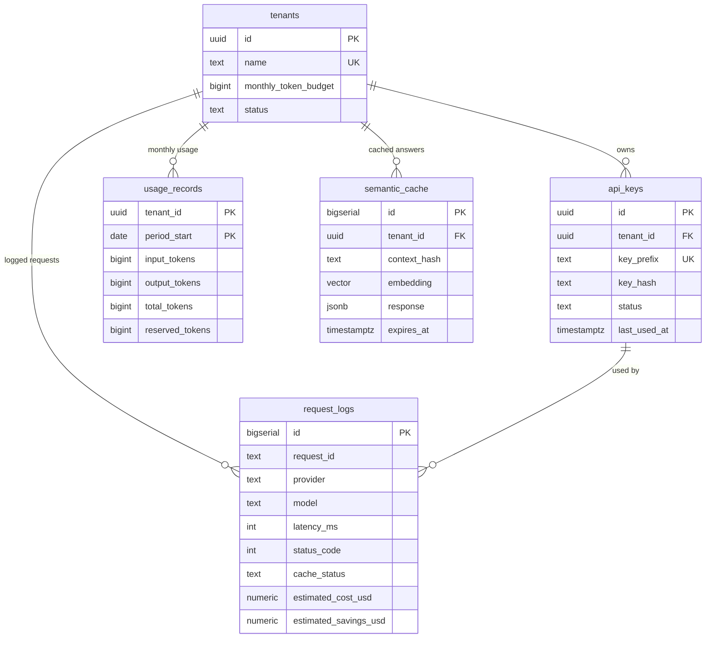

# Database design

PostgreSQL 16 with the `vector` (pgvector) and `pgcrypto` extensions. Migrations live in `migrations/` and are applied in order, each in its
own transaction, exactly once, under an advisory lock (`npm run migrate`; the compose `migrate` service does this automatically).

`provider_configs` (runtime enable flag per provider), `audit_logs` (admin actions) and `schema_migrations` are standalone.

## Tables

| Table | Notes |
|---|---|
| `tenants` | `monthly_token_budget BIGINT CHECK >= 0`, `status` ∈ active/suspended (suspended tenants' keys stop working). |
| `api_keys` | Stores **only** `key_prefix` (unique, public lookup id) and `key_hash` (HMAC-SHA256 hex). `status` ∈ active/revoked, `last_used_at` (refreshed at most once a minute per key), `revoked_at`. FK to tenant, `ON DELETE CASCADE`. |
| `usage_records` | One row per tenant per UTC month (`PRIMARY KEY (tenant_id, period_start)`). `input/output/total_tokens` are settled usage; `reserved_tokens` is the in-flight reservation. All `CHECK >= 0`. A new month is a new row, which is the monthly reset. |
| `request_logs` | One row per authenticated chat request: provider, model, tokens (+`tokens_estimated`), latency, status, `cache_status` ∈ HIT_EXACT/HIT_SEMANTIC/MISS/BYPASS, `streamed`, `estimated_cost_usd` and `estimated_savings_usd` (`NUMERIC(14,8)`, **NULL = pricing unknown**), `fallback_used`, `error_type` (the error code). Tenant/key FKs are `ON DELETE SET NULL`. |
| `semantic_cache` | `embedding vector(384)`, `context_hash` (binds model, params, system prompt and earlier turns), `prompt_text`, `response JSONB`, token counts, `expires_at`, `hit_count`. |
| `provider_configs` | `provider` PK, `enabled`, `updated_by` — persisted runtime toggle. |
| `audit_logs` | `actor`, `action`, `target_type/id`, `metadata JSONB` — provider enable/disable/failure-mode changes. |

## Indexes

| Index | Serves |
|---|---|
| `api_keys(key_prefix)` unique | Authentication lookup (one indexed row). |
| `api_keys(tenant_id)` | Key listing. |
| `usage_records` PK `(tenant_id, period_start)` | Budget reserve/settle and usage history. |
| `request_logs(created_at DESC)`, `(tenant_id, created_at DESC)`, `(request_id)`, `(cache_status, created_at DESC)` | Dashboard tables/stats and request-ID lookups. |
| `semantic_cache(tenant_id, context_hash)` | Scoping filter. |
| `semantic_cache(expires_at)` | Purge job. |
| `semantic_cache USING hnsw (embedding vector_cosine_ops)` | Approximate nearest-neighbour search by cosine distance. |

HNSW is approximate and the tenant/context filter is applied during the scan, so a very selective filter can produce a **false miss**
(never a wrong hit). Similarity is `1 - (embedding <=> query)`.

## Types and integrity decisions

* Money is `NUMERIC(14,8)`, never floating point in storage; it is cast to `float8` only for JSON output.
* Token counters are `BIGINT` with `CHECK >= 0`; the budget check is a single conditional `UPDATE` (see RATE_LIMITING.md).
* Secrets: plaintext keys are never stored. The prompt text **is** stored in `semantic_cache.prompt_text` (needed for debugging/tuning); `request_logs` stores no prompt or response content.
* The embedding dimension (384) is fixed by the column type; changing embedder dimensionality requires a migration.

## Retention and growth (not automated)

`semantic_cache` rows expire (`SEMANTIC_CACHE_TTL_SECONDS`) and are purged hourly. `request_logs`, `audit_logs` and `usage_records`
grow without bound: add retention (e.g. delete or partition by month) before running long-lived. This is listed in SECURITY_AUDIT.md.
