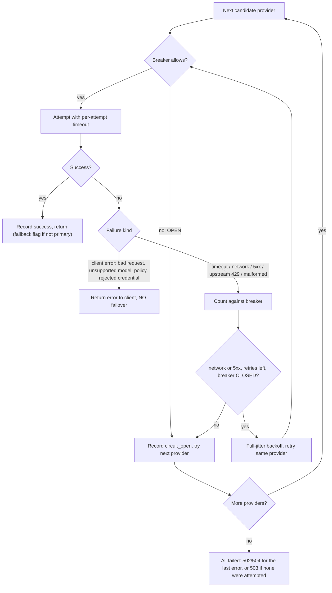

# Provider selection, fallback and retries

`ProviderManager` is the only code path from business logic to providers. For a request it:

1. Builds the ordered candidate list: providers (by `PROVIDER_PRIORITY`, then any others) that are **configured** and **list the requested model ID**.
   No match → `404 MODEL_NOT_FOUND`. Matches but all disabled → `503 NO_PROVIDER_AVAILABLE`.
2. The first candidate is the **primary** (even if an operator disabled it, so a disabled primary shows up as *fallback* in `X-Fallback-Used` and the logs).
3. Walks the enabled candidates: asks each provider's circuit breaker for permission, attempts, and on a fallback-eligible failure moves on.

> Fallback only happens between providers that serve the **same model ID**, and the gateway sends that ID to the upstream provider **unchanged**.
> **Known gap:** different vendors usually name the same model differently (e.g. Groq `llama-3.3-70b-versatile` vs an OpenRouter-style ID), so
> real cross-vendor failover is not usable today. There is no model-alias mapping (gateway name → per-provider model ID); adding one is the main
> recommended enhancement. Until then, failover is demonstrated with the mock providers `mock`/`mock-2` (both serve `mock-model`), and it works for real
> providers only when two of them accept an identical model ID.

## What triggers fallback

| Failure | Fallback to next provider? | Retry same provider? | Counts against breaker? |
|---|---|---|---|
| Timeout | yes | **no** (would double the wait) | yes |
| Network error / connection failure | yes | yes | yes |
| Upstream 5xx | yes | yes | yes |
| Upstream 429 (provider rate-limits us) | yes | no | yes |
| Malformed provider response | yes | no | yes |
| Upstream 400/422 (bad request, invalid parameters) | **no** → `400 PROVIDER_REJECTED_REQUEST` | no | no (provider answered) |
| Upstream 404 (unknown model) | **no** → `404 MODEL_NOT_FOUND` | no | no |
| Upstream 401/403 (our credential rejected) | **no** → `502 PROVIDER_MISCONFIGURED` | no | yes (a misconfigured provider is eventually taken out of rotation) |
| Client disconnected | stops the chain | no | no (neutral) |

Why not fail over client errors: the same bad request would fail identically elsewhere, wasting a call and hiding the real problem.

## Retries (bounded on purpose)

* At most `PROVIDER_MAX_RETRIES` (default 1) retries per provider, only for network/5xx, with **full-jitter** exponential backoff (`random(0, min(2 s, base·2^n))`, base `PROVIDER_RETRY_BASE_DELAY_MS`).
* No retry while the breaker is HALF_OPEN or not CLOSED, and every retry goes back through the breaker — so a failing provider trips it quickly instead of being hammered.
* Everything for one request shares `PROVIDER_TOTAL_TIMEOUT_MS`; each attempt has `PROVIDER_TIMEOUT_MS`.
* Worst-case amplification per request is `(1 + retries) × providers` attempts, and only until the breaker opens — avoiding retry storms during an outage.
* **Streams:** retry/fallback is possible only until the first chunk is forwarded (see STREAMING.md).

## When every provider fails
`502 PROVIDER_ERROR` (or `504 PROVIDER_TIMEOUT` if the last failure was a timeout); `503 NO_PROVIDER_AVAILABLE` if every candidate was disabled/OPEN so nothing was attempted. The token reservation is released, nothing is cached, and the failure is recorded in the request log and metrics.
Upstream error bodies are never forwarded.

## Operator controls
Dashboard or `POST /api/providers/:p/disable|enable` (admin token, persisted, audited) force failover on demand; `failure-mode` on mock providers injects `http_500`, `http_503`, `timeout`, `bad_request` or `stream_cut`.
